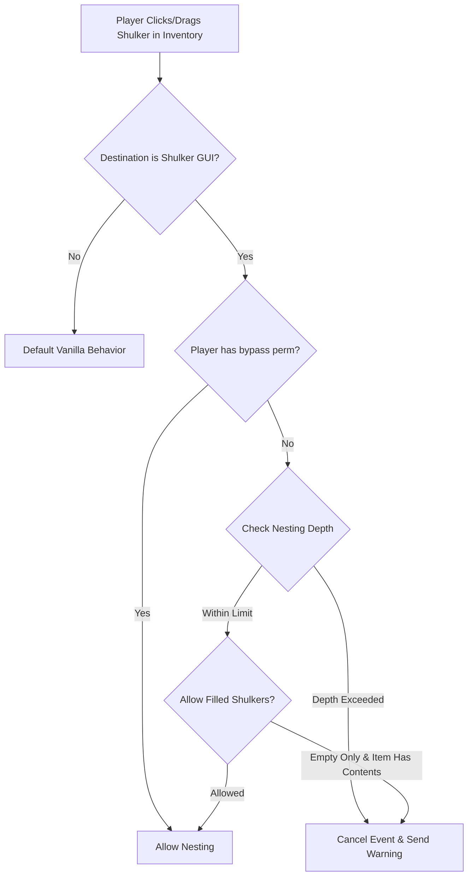

# Nested Shulkers

Paper plugin that lets you nest shulker boxes inside other shulker boxes.

## Quick Start

1. Download the jar from the [latest release](https://github.com/KitsuneTech1/ShulkerInShulker/releases/tag/v1.0.0) or build from source with `mvn clean package`.
2. Drop the jar into your Paper server's `plugins/` folder.
3. Restart the server. Do not use `/reload`; do a full restart.
4. Run `/shulkerinshulker` in-game to verify it loaded.

Players can now place shulker boxes inside other shulker boxes.

## Configuration

The plugin generates `config.yml` on first load. Key options:

- `max-nesting-depth` - how many levels deep shulkers can be nested (0 = unlimited)
- `allow-filled-shulkers` - whether filled shulker boxes can be nested (default: true)
- `show-nesting-message` - whether to chat a message when a player nests a shulker box
- `nesting-message` - the message text; supports `&` color codes

## Architecture & Mechanics

## Commands

| Command | Aliases | Permission | What it does |
|---|---|---|---|
| `/shulkerinshulker` | `/sis`, `/shulkerbox` | `shulkerinshulker.use` | Shows plugin status and max nesting depth |
| `/shulkerinshulker reload` | | `shulkerinshulker.admin` | Reloads config.yml |

## Permissions

| Permission | Default | What it does |
|---|---|---|
| `shulkerinshulker.use` | true | Nest shulker boxes, run the status command |
| `shulkerinshulker.bypass` | op | Ignore the max nesting depth limit |
| `shulkerinshulker.admin` | op | Reload the plugin configuration |

## Install from Source

Requirements:
- Java 21 (get it from https://adoptium.net, verify with `java -version`)
- Maven 3.6+

Steps:
1. Clone the repo: `git clone https://github.com/KitsuneTech1/ShulkerInShulker.git`
2. `cd ShulkerInShulker`
3. Run `mvn clean package`
4. The built jar is at `target/ShulkerInShulker-1.0.0.jar`
5. Drop it into your Paper server's `plugins/` folder and restart

## Troubleshooting

- `UnsupportedClassVersionError` when the server starts - you're using Java 20 or older. Install Java 21 from https://adoptium.net.
- Plugin fails to load or shows an unsupported API version warning - your server isn't running Paper 1.21.
- Shulker boxes still won't nest after installing - make sure you did a full restart (not `/reload`), and check that your player has the `shulkerinshulker.use` permission.

## License

MIT. Copyright (c) 2026 Kitsune Technologies LLC. Do what you like with it, commercially or otherwise, just keep the copyright notice. Full text in [LICENSE](LICENSE).

---

Part of <b>Buildtober 2026</b>: 31 open source projects in 31 days. Built by <a href="https://kitsunetechnologies.org/work">Kitsune Technologies</a>. More at <a href="https://github.com/KitsuneTech1">github.com/KitsuneTech1</a>.

